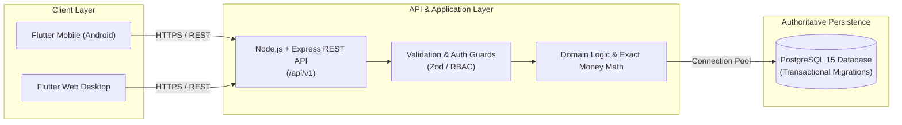

# 🍽️ EatFirm — Food Delivery Management System (FDMS)

[](https://flutter.dev)
[](https://nodejs.org)
[](https://www.typescriptlang.org)
[](https://www.postgresql.org)
[](https://github.com)
[](https://opensource.org/licenses/MIT)

> **"Gourmet at your doorstep"** — A robust, production-grade food commerce and delivery management platform connecting Customers, Restaurant Admins, Delivery Partners, and System Administrators through an intuitive, streamlined workflow.

---

## 📖 Table of Contents
1. [Purpose & Project Overview](#-purpose--project-overview)
2. [Architecture & System Boundaries](#-architecture--system-boundaries)
3. [Key Features by Role](#-key-features-by-role)
4. [Tech Stack](#-tech-stack)
5. [Prerequisites](#-prerequisites)
6. [How to Download & Install](#-how-to-download--install)
7. [Database Setup & Migrations](#-database-setup--migrations)
8. [Running the Application](#-running-the-application)
9. [Running Tests & Quality Gates](#-running-tests--quality-gates)
10. [Project Directory Structure](#-project-directory-structure)
11. [Module Implementation Roadmap](#-module-implementation-roadmap)
12. [Authors & Academic Context](#-authors--academic-context)

---

## 🎯 Purpose & Project Overview

EatFirm is developed according to the approved **Software Requirements Specification (SRS Version 1.0)** for the Software Engineering Lab project at **Bharatiya Vidya Bhavan's Sardar Patel Institute of Technology (SPIT), Mumbai**.

The platform replaces informal phone-based and walk-in ordering processes with an automated digital lifecycle:
- **Customers**: Browse and compare restaurants by pricing, delivery time, and ratings; manage shopping carts; place Cash on Delivery (COD) orders; and track deliveries in real time.
- **Restaurants**: Onboard onto the platform, manage menu categories and dishes, configure seasonal offers, and manage incoming orders in 2 taps.
- **Delivery Partners**: Receive optimized order pickup and drop assignments, and confirm deliveries via secure customer OTP.
- **System Administrators**: Review restaurant onboarding applications, monitor system performance, and audit transactions.

---

## 🏛️ Architecture & System Boundaries



- **Client Layer (Flutter)**: Presentation and input capture only. Client state is never trusted for totals, authorization, or business status transitions.
- **Backend API (Node.js/Express)**: Owns business rules, server-side validation, role-based access control (RBAC), and transactional integrity.
- **Authoritative Database (PostgreSQL)**: Persists records with strict foreign keys, UTC timestamps (`TIMESTAMPTZ`), and exact decimal monetary values (`NUMERIC(12,2)`) avoiding floating-point rounding errors (SRS CO-7).

---

## 👥 Key Features by Role

| Role | Scope & Permissions |
| :--- | :--- |
| **Customer** | Discover approved restaurants, search dishes, manage cart, place orders (Cash on Delivery), track order timeline, submit reviews. |
| **Restaurant Admin** | Manage restaurant profile, operational hours, menu items (veg/non-veg tags, pricing), toggle item availability. |
| **Delivery Partner** | Accept delivery assignments, view turn-by-turn pickup and drop locations, confirm deliveries using customer OTP. |
| **System Administrator** | Approve/reject restaurant onboarding applications, monitor audit logs, manage user accounts. |

---

## 💻 Tech Stack

* **Mobile & Web UI**: [Flutter 3.47+](https://flutter.dev) / [Dart 3.13+](https://dart.dev) (Material 3, GoRouter, Responsive scaffolding).
* **REST Backend**: [Node.js v22+](https://nodejs.org) + [TypeScript](https://www.typescriptlang.org) + [Express](https://expressjs.com).
* **Database**: [PostgreSQL 15+](https://www.postgresql.org) with transactional migration engine.
* **Testing**: Node.js Native Test Runner, Supertest, Flutter Test.
* **Observability**: Structured JSON logging with automated secret masking (`password`, `token`, `otp`, `card`), request correlation tracking via `X-Request-Id`.

---

## ⚙️ Prerequisites

Before installing, ensure the following are installed on your machine:
1. **Node.js**: `v20.0.0` or higher (`v22` recommended) & `npm` (`v10+`).
2. **Flutter SDK**: `v3.24.0` or higher (`v3.47.3` recommended) with Dart.
3. **PostgreSQL**: `v14` or `v15` running locally or on a remote server.
4. **Git**: Installed and configured.

---

## 📥 How to Download & Install

### 1. Clone the Repository
```bash
git clone https://github.com/your-username/EatFirm.git
cd EatFirm
```

### 2. Install Backend Dependencies
```bash
cd backend
npm install
```

### 3. Install Frontend Dependencies
```bash
cd ../frontend
flutter pub get
```

---

## 🗄️ Database Setup & Migrations

### 1. Configure Environment Variables
Inside `backend/`, copy the `.env.example` file to `.env`:
```bash
cd backend
cp .env.example .env
```

Edit `backend/.env` with your PostgreSQL credentials:
```env
PORT=5000
HOST=0.0.0.0

DB_HOST=127.0.0.1
DB_PORT=5432
DB_NAME=eatfirm_dev
DB_USER=postgres
DB_PASSWORD=your_postgres_password

JWT_SECRET=eatfirm_development_jwt_secret_key_minimum_32_characters_foundation
LOG_LEVEL=info
```

### 2. Create the Database & Run Migrations
In PostgreSQL (`psql` or pgAdmin), create the databases:
```sql
CREATE DATABASE eatfirm_dev;
CREATE DATABASE eatfirm_test;
```

Run the transactional migrations:
```bash
npm run migrate
```
*(To roll back a migration: `npm run migrate:down`)*

---

## 🚀 Running the Application

### 1. Start the Backend REST API
From the `backend/` directory:
```bash
npm run dev
```
* API Server: `http://localhost:5000/api/v1`
* Liveness Health Check: `http://localhost:5000/api/v1/health`
* Infrastructure Readiness Check: `http://localhost:5000/api/v1/ready`

### 2. Start the Flutter Client
From the `frontend/` directory:

#### Run on Web (Chrome / Edge)
```bash
flutter run -d edge
# or
flutter run -d chrome
```

#### Run on a Physical Android Phone (over Wi-Fi or USB)
```bash
flutter run
```
> **Note for Physical Devices on Wi-Fi**: The app automatically uses your computer's local Wi-Fi IP address (e.g. `http://192.168.1.36:5000/api/v1`) so your phone can communicate seamlessly with the local backend. You can also override it at runtime:
> ```bash
> flutter run --dart-define=API_URL=http://<YOUR_IP>:5000/api/v1
> ```

---

## 🧪 Running Tests & Quality Gates

EatFirm enforces a strict quality gate before declaring any module complete.

### Backend Tests (19 tests)
Tests cover configuration loading, secret masking, exact decimal arithmetic, Indian digit formatting, health/readiness endpoints, correlation ID headers, 404 handling, and rate limiting:
```bash
cd backend
npm test
```

### Backend Build Compilation
```bash
cd backend
npm run build
```

### Frontend Static Analysis & Tests (25 tests)
Tests cover theme tokens, responsive breakpoints, API client error mapping, button states, input validation, empty/error states, and localization:
```bash
cd frontend
flutter analyze
flutter test
```

### Web Release Build
```bash
cd frontend
flutter build web --release
```

---

## 📁 Project Directory Structure

```text
EatFirm/
├── backend/
│   ├── src/
│   │   ├── config/          # Zod schema validation & secret masking
│   │   ├── database/        # Connection pool, transaction helper, migrations
│   │   ├── logger/          # Structured JSON logging with redaction
│   │   ├── middleware/      # RequestId, RequestLogger, ErrorHandler, RateLimiter, RBAC
│   │   ├── routes/          # /health, /ready endpoints
│   │   ├── utils/           # Exact money math, response envelopes, pagination
│   │   ├── app.ts           # Express assembly
│   │   └── server.ts        # Server bootstrap & graceful shutdown
│   ├── tests/               # 19 integration and unit tests
│   └── package.json
│
├── frontend/
│   ├── lib/
│   │   ├── core/
│   │   │   ├── constants/   # App constants & network defaults
│   │   │   ├── localization/# AppStrings dictionary (SRS Section 6)
│   │   │   ├── network/     # ApiClient, ApiExceptions, ApiResponses
│   │   │   ├── routing/     # GoRouter configuration & routes
│   │   │   ├── theme/       # Design tokens (Colors, Typography, Spacing, Radius, Responsive)
│   │   │   └── utils/       # Date formatting (IST DD-MM-YYYY) & INR currency
│   │   ├── features/
│   │   │   └── foundation/  # BootstrapScreen, NavigationShellScreen, FoundationShowcaseScreen
│   │   ├── shared/
│   │   │   └── widgets/     # AppButton, AppTextField, AppCard, AppBadge, AppDialog, etc.
│   │   └── main.dart        # Flutter entry point
│   ├── test/                # 25 widget & unit tests
│   └── pubspec.yaml
│
├── docs/                    # Implementation documentation
│   ├── ADR.md               # Architecture Decision Records
│   ├── API_CONTRACT.md      # API specification & response envelopes
│   ├── ERD.md               # Shared Entity-Relationship diagram & Data Dictionary
│   ├── DECISIONS_TBD.md     # Open decisions & TBD register
│   ├── TRACEABILITY_MATRIX.md # SRS requirement to test traceability
│   └── modules/             # Owner specifications (Modules 01 to 10)
│
├── GLOBAL_ARCHITECTURE.md   # System contracts, ER model, & rules
├── README.md                # This file
└── SRS_FDMS.pdf             # Authoritative Software Requirements Specification
```

---

## 🗺️ Module Implementation Roadmap

EatFirm is developed in a 10-module sequence:

- [x] **Module 01: Foundation, Architecture, and Design System** *(Complete)*
- [x] **Module 02: Registration, Login, Sessions, and Role-Based Access** *(Next)*
- [x] **Module 03: Restaurant Onboarding and Menu Management**
- [x] **Module 04: Customer Browse, Search, and Filtering**
- [x] **Module 05: Cart Management, Order Placement, and Scheduling**
- [x] **Module 06: Cash on Delivery (COD) Payment and Invoices**
- [ ] **Module 07: Real-Time Order and Delivery Tracking**
- [ ] **Module 08: Delivery Partner Assignment and Handover**
- [ ] **Module 09: Customer Support, Complaints, and Ratings**
- [ ] **Module 10: System Administration, Hardening, and Release**

---

## 👨‍💻 Authors & Academic Context

* **Project**: Food Delivery Management System (FDMS) — Release 1.0
* **Course**: Software Engineering Lab
* **Institution**: Sardar Patel Institute of Technology (SPIT), Mumbai
* **Prepared by**: Keertan Nayak & Piyush Orke (August 2026)

---

## 📄 License
This project is licensed under the MIT License — see the [LICENSE](LICENSE) file for details.
