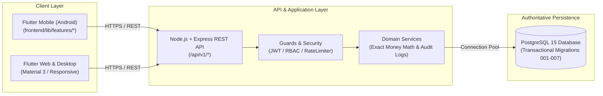

# 🍽️ EatFirm — Food Delivery Management System (FDMS)

[](https://flutter.dev)
[](https://nodejs.org)
[](https://www.typescriptlang.org)
[](https://www.postgresql.org)
[](https://github.com)
[](https://github.com)
[](https://opensource.org/licenses/MIT)

> **"Gourmet at your doorstep"** — A multi-role food commerce and delivery management platform connecting Customers, Restaurant Admins, Delivery Partners, and System Administrators through an intuitive, streamlined workflow.

---

## 📖 Table of Contents
1. [Purpose & Project Overview](#-purpose--project-overview)
2. [Architecture & System Boundaries](#-architecture--system-boundaries)
3. [Key Features by Role](#-key-features-by-role)
4. [Tech Stack](#-tech-stack)
5. [Prerequisites](#-prerequisites)
6. [Download, Installation & Setup](#-download-installation--setup)
7. [Database Setup & Migrations](#-database-setup--migrations)
8. [Running the Application](#-running-the-application)
9. [Running Tests & Quality Gates](#-running-tests--quality-gates)
10. [Comprehensive File & Directory Guide](#-comprehensive-file--directory-guide)
    - [Root Level Structure](#1-root-level-files)
    - [Backend Architecture & File Map](#2-backend-architecture--file-map-backendsrc)
    - [Frontend Architecture & File Map](#3-frontend-architecture--file-map-frontendlib)
    - [Test Suites](#4-test-suites-file-map)
11. [Module Implementation Roadmap](#-module-implementation-roadmap)
12. [License](#-license)

---

## 🎯 Purpose & Project Overview

EatFirm provides an automated, secure food commerce and delivery platform:
- **Customers**: Discover dining spots, filter menus by diet (`Veg`/`Non-Veg`) and price, manage shopping carts, place Cash on Delivery (COD) orders, receive GST tax invoices, and track live order progress with delivery partner GPS.
- **Restaurant Admins**: Complete onboarding, curate menu categories and dishes, toggle instant item availability, and manage kitchen preparation states in 2 taps.
- **Delivery Partners**: View active orders, access pickup and delivery locations with contact capabilities, update fulfillment transitions (`OUT_FOR_DELIVERY`, `DELIVERED`), collect doorstep cash payments, and broadcast real-time GPS telemetry coordinates.
- **System Administrators**: Review and approve restaurant onboarding submissions, monitor audit logs with correlation IDs, manage user statuses, and oversee platform performance.

---

## 🏛️ Architecture & System Boundaries



### Architectural Principles:
1. **Zero-Trust Client**: Client-side totals, statuses, and permissions are never trusted. All monetary calculations (subtotal, delivery fee, packaging fee, 5% GST, grand total) are calculated authoritatively on the backend using exact integer-scaled arithmetic.
2. **Audit & Traceability**: Critical lifecycle events (user registrations, restaurant approvals, cancellations, cash collections) generate persistent audit entries with IP addresses and user agents.
3. **Structured Observability**: Every HTTP request receives an `X-Request-Id` UUID. Logs are structured JSON with sensitive credentials (`password`, `token`, `otp`, `card`) automatically sanitized.

---

## 👥 Key Features by Role

| Role | Scope & Permissions | Key Screens & Endpoints |
| :--- | :--- | :--- |
| **CUSTOMER** | Discover verified restaurants, filter menus, add dishes to persistent cart, place COD orders, view official tax invoices, and track live driver location. | `/browse`, `/cart`, `/checkout`, `/orders/:id`, `/orders/:id/tracking`, `/orders/:id/invoice` |
| **RESTAURANT_ADMIN** | Register restaurant profile, submit FSSAI license, set weekly hours, create menu categories/items, toggle in-stock availability, accept/confirm/prepare orders. | `/restaurant/dashboard`, `/restaurant/onboard`, `/restaurant/menu`, `/restaurant/hours` |
| **DELIVERY_PARTNER** | View order assignments, mark orders picked up (`OUT_FOR_DELIVERY`), transmit live GPS telemetry, collect COD cash payments, complete handover (`DELIVERED`). | `/orders/:id`, `/orders/:id/tracking`, `/orders/:id/status`, `POST /orders/:id/tracking/location` |
| **SYSTEM_ADMIN** | Review pending restaurant approvals, inspect operational metrics, audit transactions, manage global system state. | `/admin/approvals`, `/api/v1/health`, `/api/v1/ready` |

---

## 💻 Tech Stack

* **Frontend**: [Flutter 3.47+](https://flutter.dev) (Dart 3.13+), Material 3, `go_router` for declarative nested routing, `provider` for state management, `http` for network communication.
* **Backend**: [Node.js v22+](https://nodejs.org) + [TypeScript 5.7](https://www.typescriptlang.org) + [Express 4.21](https://expressjs.com) (ESM module architecture).
* **Database**: [PostgreSQL 15+](https://www.postgresql.org) with strict relational schemas, foreign keys, constraints, and custom transactional migration engine.
* **Authentication**: Password hashing with `bcryptjs` (salt rounds: 10), stateful JSON Web Tokens (`jsonwebtoken`) with role-based route guards.
* **Validation**: Runtime request payload schema validation using `zod`.
* **Testing**: Node.js Native Test Runner (`tsx --test`), Supertest, Flutter Test framework.

---

## ⚙️ Prerequisites

Before installing, ensure your development environment has:
1. **Node.js**: `v20.0.0` or higher (`v22` recommended) & `npm` (`v10+`).
2. **Flutter SDK**: `v3.24.0` or higher (`v3.47.3` recommended) with Android toolchain / Chrome.
3. **PostgreSQL**: `v14` or `v15` running on port `5432`.
4. **Git**: Installed and accessible on PATH.

---

## 📥 Download, Installation & Setup

### 1. Clone the Repository
```bash
git clone https://github.com/your-username/EatFirm.git
cd EatFirm
```

### 2. Install Backend Dependencies
```bash
cd backend
npm install
```

### 3. Install Frontend Dependencies
```bash
cd ../frontend
flutter pub get
```

---

## 🗄️ Database Setup & Migrations

### 1. Create PostgreSQL Databases
Using `psql` or pgAdmin:
```sql
CREATE DATABASE eatfirm_dev;
CREATE DATABASE eatfirm_test;
```

### 2. Configure Backend Environment
In `backend/`, copy `.env.example` to `.env`:
```bash
cd backend
cp .env.example .env
```
Ensure your database credentials match in `backend/.env`:
```env
PORT=5000
HOST=0.0.0.0

DB_HOST=127.0.0.1
DB_PORT=5432
DB_NAME=eatfirm_dev
DB_USER=postgres
DB_PASSWORD=your_postgres_password
DB_SSL=false
DB_POOL_MAX=20
DB_TIMEOUT_MS=10000

CORS_ORIGIN=*
JWT_SECRET=eatfirm_development_jwt_secret_key_minimum_32_characters_foundation
LOG_LEVEL=info
```

### 3. Execute Migrations
Run all migrations sequentially (Modules 01 through 07):
```bash
npm run migrate
```
*(To roll back the most recent migration: `npm run migrate:down`)*

---

## 🚀 Running the Application

### 1. Start the Backend API Server
```bash
cd backend
npm run dev
```
* **Base URL**: `http://localhost:5000/api/v1`
* **Liveness Probe**: `http://localhost:5000/api/v1/health`
* **Readiness Probe**: `http://localhost:5000/api/v1/ready`

### 2. Launch the Flutter Client
```bash
cd frontend
```
* **On Web (Chrome / Edge)**:
  ```bash
  flutter run -d chrome
  ```
* **On Connected Android Phone (USB / Wireless ADB)**:
  ```bash
  flutter run
  ```
  > **Android Emulator**: The app automatically uses `10.0.2.2`, which points to
  > the development machine from the emulator.
  >
  > **Physical Devices**: The app automatically discovers the backend over the
  > local network at startup. The phone and development machine must be on the
  > same Wi-Fi network. The backend listens on all network interfaces
  > (`HOST=0.0.0.0`) and advertises its current address over UDP discovery, so
  > changing Wi-Fi networks does not require a code change.
  >
  > Allow inbound TCP port `5000` and UDP port `5001` through the development
  > machine's firewall. If the network blocks broadcast traffic, use the
  > optional override:
  > ```bash
  > flutter run --dart-define=API_URL=http://<YOUR_LOCAL_IP>:5000/api/v1
  > ```
  >
  > **Web / Desktop / iOS Simulator**: The client derives the API host from
  > the browser host or uses `localhost` respectively.

---

## 🧪 Running Tests & Quality Gates

### Run Backend Tests (129 Integration & Unit Tests)
```bash
cd backend
npm test
```
*Tests cover auth lifecycle, RBAC enforcement, menu management, search queries, cart checkout, exact tax invoice generation, and live GPS tracking.*

### Run Backend TypeScript Compilation
```bash
cd backend
npm run build
```

### Run Frontend Static Analysis & Tests (72 Unit & Widget Tests)
```bash
cd frontend
flutter analyze
flutter test
```
*Tests cover responsive breakpoints, API client error mapping, input validation, dialogs, invoices, cart providers, and live tracking screens.*

---

## 📁 Comprehensive File & Directory Guide

This section lists the non-gitignored repository files tracked in source control and explains the responsibility of each module.

### 1. Root Level Files
| File / Directory | Purpose & Description |
| :--- | :--- |
| `README.md` | Developer onboarding guide, setup instructions, architecture summary, and file catalog. |
| `.gitignore` | Defines files, build directories, and environment secrets ignored by Git. |
| `backend/` | Node.js + Express + TypeScript REST API and database migrations. |
| `frontend/` | Flutter cross-platform client (Android, iOS, Web, Desktop). |

---

### 2. Backend Architecture & File Map (`backend/src`)

The backend is built as a layered TypeScript/Express architecture with strict separation between routing, business domain logic, database operations, and middleware.

```text
backend/
├── package.json                    # Project dependencies, scripts (dev, build, migrate, test)
├── tsconfig.json                   # TypeScript compiler settings (ES2022, NodeNext modules)
├── .env.example                    # Template for required environment variables
└── src/
    ├── app.ts                      # Express application assembly & middleware pipeline
    ├── server.ts                   # HTTP server bootstrap, port binding & graceful shutdown
    ├── config/
    │   └── index.ts                # Zod environment variable parsing, validation & defaults
    ├── database/
    │   ├── db.ts                   # PostgreSQL connection pool with query telemetry
    │   ├── migrator.ts             # Transactional SQL migration engine (.sql & .down.sql)
    │   ├── runMigrations.ts        # CLI migration runner (up / down)
    │   └── migrations/             # Sequential SQL schema migrations
    │       ├── 001_foundation.sql  # System health & audit log tables
    │       ├── 002_auth.sql        # Users, auth sessions, password resets, OTPs
    │       ├── 003_restaurant.sql  # Restaurants, operational hours, categories, menu items
    │       ├── 004_browse.sql      # Full-text search indexes & geospatial views
    │       ├── 005_cart_order.sql  # Carts, cart items, orders, order items, status events
    │       ├── 006_cod_payment_invoice.sql # Payments, tax invoices, cash collection logs
    │       └── 007_tracking.sql    # Live partner GPS location telemetry table & indexes
    ├── logger/
    │   └── index.ts                # Structured JSON logger with automated credential redaction
    ├── middleware/
    │   ├── authGuard.ts            # JWT authentication guard & requireRoles() RBAC middleware
    │   ├── errorHandler.ts         # Centralized error handler returning uniform error envelopes
    │   ├── rateLimiter.ts          # In-memory sliding-window IP rate limiter
    │   ├── requestId.ts            # Attaches unique X-Request-Id UUID to incoming requests
    │   └── requestLogger.ts        # Logs HTTP method, URL, status code, latency, and request ID
    ├── models/
    │   ├── cart.ts                 # TypeScript interfaces for carts, items, and totals
    │   ├── order.ts                # Domain interfaces for orders, status events, and tracking
    │   ├── payment.ts              # Interfaces for COD payments, tax invoices, and line items
    │   └── restaurant.ts           # Interfaces for restaurants, menus, categories, and hours
    ├── routes/
    │   ├── auth.ts                 # /api/v1/auth: register, login, profile, password reset, OTP
    │   ├── cart.ts                 # /api/v1/cart: add item, update quantity, clear cart
    │   ├── health.ts               # /api/v1/health & /api/v1/ready: liveness and DB readiness
    │   ├── order.ts                # /api/v1/orders: checkout, status updates, cancel, tracking
    │   ├── payment.ts              # /api/v1/payments: cash collection, invoice retrieval
    │   └── restaurant.ts           # /api/v1/restaurants: onboarding, approval, menus, browse
    ├── services/
    │   ├── auditService.ts         # Logs security and business transactions to audit_logs
    │   ├── authService.ts          # Passwords, JWT issuing/verification, OTP generation
    │   ├── cartService.ts          # Cart persistence, dish pricing lookup, validation
    │   ├── notificationService.ts  # Multi-channel notification dispatch stub
    │   ├── orderService.ts         # Order lifecycle, status transitions, cancellations, telemetry
    │   ├── paymentGateway.ts       # Payment processor abstraction interface
    │   ├── paymentService.ts       # COD collection verification, invoice calculations
    │   └── restaurantService.ts    # Restaurant CRUD, menu catalog management, search queries
    └── utils/
        ├── money.ts                # Exact decimal integer-scaled arithmetic (avoids float error)
        └── response.ts             # Uniform sendSuccess() and sendError() response wrappers
```

---

### 3. Frontend Architecture & File Map (`frontend/lib`)

The Flutter client uses a feature-first architectural pattern with centralized design tokens, declarative routing with authentication redirects, and dedicated API service layers.

```text
frontend/
├── pubspec.yaml                    # Flutter package dependencies, assets & fonts configuration
└── lib/
    ├── main.dart                   # App entry point, Provider wiring, and MaterialApp initialization
    │
    ├── core/                       # Foundation infrastructure
    │   ├── constants/
    │   │   └── app_constants.dart  # Global API URLs, storage keys, and timeout thresholds
    │   ├── localization/
    │   │   └── app_strings.dart    # Centralized user-facing UI strings
    │   ├── network/
    │   │   ├── api_client.dart     # HTTP wrapper adding JWT bearer tokens & parsing envelopes
    │   │   ├── api_exception.dart  # Strongly-typed exceptions for network/validation errors
    │   │   └── api_response.dart   # Generic ApiResponse<T> deserializer
    │   ├── routing/
    │   │   ├── app_router.dart     # GoRouter setup with auth guard and role-based redirects
    │   │   └── app_routes.dart     # Constant path definitions and route helper functions
    │   ├── theme/                  # Centralized Material 3 Design System
    │   │   ├── app_colors.dart     # Primary, secondary, error, veg/non-veg color palette
    │   │   ├── app_radius.dart     # Standard border radius tokens (sm, md, lg, xl)
    │   │   ├── app_spacing.dart    # 8pt-grid spacing tokens (xs, sm, md, lg, xl)
    │   │   ├── app_theme.dart      # Light/Dark ThemeData configurations and button styles
    │   │   ├── app_typography.dart # Inter-based text styling hierarchy
    │   │   └── responsive.dart     # Breakpoint utilities (Mobile, Tablet, Desktop)
    │   └── utils/
    │       ├── currency_formatter.dart # Indian Rupee (₹) digit grouping formatter
    │       └── date_formatter.dart # IST timestamp formatting
    │
    ├── features/                   # Modular business domains
    │   ├── auth/                   # Authentication & RBAC
    │   │   ├── models/user_model.dart # UserModel deserializer with role parsing
    │   │   ├── screens/            # Login, Register, Profile, Reset Password, Access Denied
    │   │   └── services/           # AuthApiService & SessionManager (SharedPreferences)
    │   │
    │   ├── restaurant/             # Restaurant & Menu Management
    │   │   ├── models/             # Restaurant, MenuCategory, MenuItem, OperatingHours models
    │   │   ├── screens/            # Dashboard, Onboarding, Menu Management, Admin Approvals
    │   │   ├── services/           # RestaurantApiService
    │   │   └── widgets/            # VegIndicator, MenuItemDialog
    │   │
    │   ├── browse/                 # Customer Discovery & Search
    │   │   ├── models/             # Filter models, Menu models, Search suggestions
    │   │   ├── providers/          # BrowseProvider with debounced real-time search
    │   │   ├── screens/            # CustomerDiscoveryScreen, CustomerRestaurantMenuScreen
    │   │   ├── services/           # BrowseApiService
    │   │   └── widgets/            # RestaurantCard, FilterBottomSheet, RestaurantCompareSheet
    │   │
    │   ├── cart_order/             # Cart & Order Placement
    │   │   ├── models/             # CartModel, OrderModel, OrderItemModel
    │   │   ├── providers/          # CartOrderProvider (cart management & order placement)
    │   │   ├── screens/            # CartScreen, CheckoutScreen, OrderConfirmation, OrderDetail, History
    │   │   └── services/           # CartOrderApiService
    │   │
    │   ├── payment_invoice/        # COD Payments & Tax Invoices
    │   │   ├── models/             # PaymentModel, InvoiceModel, InvoiceLineItemModel
    │   │   ├── providers/          # PaymentInvoiceProvider (recording cash & loading invoices)
    │   │   ├── screens/            # InvoiceDetailScreen (official GST tax invoice view)
    │   │   └── services/           # PaymentInvoiceApiService
    │   │
    │   ├── tracking/               # Live Order & Delivery Tracking
    │   │   ├── models/             # OrderTrackingModel, LocationModel, TimelineEventModel
    │   │   ├── providers/          # TrackingProvider (auto-polling & GPS telemetry updates)
    │   │   ├── screens/            # OrderTrackingScreen (timeline, partner details, live telemetry)
    │   │   └── services/           # TrackingApiService
    │   │
    │   └── foundation/             # Core App Scaffolding
    │       └── screens/            # BootstrapScreen (health verification), NavigationShellScreen
    │
    └── shared/widgets/             # Reusable Design System Components
        ├── app_badge.dart          # Status chip badge (Active, Pending, Delivered)
        ├── app_button.dart         # Primary, outline, and destructive button states
        ├── app_card.dart           # Elevated container with consistent padding and borders
        ├── app_dialog.dart         # Reusable confirmation dialogs
        ├── app_empty_state.dart    # Empty list fallback view with call to action
        ├── app_error_state.dart    # Network/error fallback view with retry button
        ├── app_loading.dart        # Unified circular progress indicators
        ├── app_scaffold.dart       # Standard screen layout with responsive margins
        ├── app_snackbar.dart       # Success, info, and error snackbars
        └── app_text_field.dart     # Standardized text inputs with validation states
```

---

### 4. Test Suites File Map

#### Backend Tests (`backend/tests/`)
| Test File | Coverage & Purpose |
| :--- | :--- |
| `api.test.ts` | Health checks, readiness probe, rate limiter, and error envelopes. |
| `auth.test.ts` | Registration, login, duplicate email handling, JWT authentication, and RBAC guards. |
| `restaurant.test.ts` | Multi-step onboarding, admin approval/rejection, menu categories, dish availability. |
| `browse.test.ts` | Restaurant search, filtering by rating/cuisine, price sort, and menu browsing. |
| `cart_order.test.ts` | Cart calculations, multi-restaurant conflict prevention, COD checkout, order cancel. |
| `payment_invoice.test.ts` | Doorstep cash collection, duplicate payment rejection, GST tax invoice generation. |
| `tracking.test.ts` | Timeline event recording, GPS telemetry validation, authorized tracking retrieval. |
| `money.test.ts` | Integer-scaled arithmetic, decimal precision, tax computations. |
| `migrator.test.ts` | Up and down migration idempotency and transaction rollbacks. |

#### Frontend Tests (`frontend/test/`)
| Test File | Coverage & Purpose |
| :--- | :--- |
| `theme_test.dart` | Color tokens, typography, and spacing consistency. |
| `responsive_test.dart` | Breakpoint detection across mobile, tablet, and desktop screens. |
| `api_client_test.dart` | HTTP interceptors, token attachment, and exception mapping. |
| `utils_test.dart` | Indian currency (₹) and IST date formatting logic. |
| `features/auth/*_test.dart` | Login screen validation, session storage, and role-based redirects. |
| `features/restaurant/*_test.dart` | Veg/Non-Veg indicators, menu editors, and restaurant dashboard widgets. |
| `features/browse/*_test.dart` | Restaurant search, filter bottom sheet, and menu comparison cards. |
| `features/cart_order/*_test.dart` | Cart item increment/decrement, checkout flows, and order status banners. |
| `features/payment_invoice/*_test.dart` | Official tax invoice UI layout, cash collection buttons, and print triggers. |
| `features/tracking/*_test.dart` | Real-time status timeline, partner information, and live GPS telemetry cards. |
| `widgets/*_test.dart` | AppButton, AppTextField, AppEmptyState, and AppErrorState widgets. |

---

## 🗺️ Module Implementation Roadmap

- [x] **Module 01: Foundation, Architecture, and Design System**
- [x] **Module 02: Registration, Login, Sessions, and Role-Based Access (RBAC)**
- [x] **Module 03: Restaurant Onboarding, Operating Hours, and Menu Management**
- [x] **Module 04: Customer Browse, Multi-Criteria Search, and Dish Filtering**
- [x] **Module 05: Cart Management, Order Placement, and Cancellation Lifecycle**
- [x] **Module 06: Cash on Delivery (COD) Payments and GST Tax Invoicing**
- [x] **Module 07: Real-Time Order Timeline, Delivery Partner Telemetry & GPS Tracking**
- [ ] **Module 08: Delivery Partner Smart Assignment and Contactless Handover**
- [ ] **Module 09: Customer Support, Disputes, and Ratings & Reviews**
- [ ] **Module 10: System Administration, Security Hardening, and Production Release**

---

## 📄 License
This project is licensed under the MIT License — see the [LICENSE](LICENSE) file for details.
